# Implementation Report: Auditory Filter Model Frontends for Speaker Gender Recognition

**Date:** 2026-10-03  
**Code alignment:** authors’ [SGR_AFM](https://github.com/HosseinFayyazi/SGR_AFM) (kernels, cutoffs, LayerNorm, RMSprop, evaluation protocol)  
**Reference:** Fayyazi, H., & Shekofteh, Y. (2023). *Exploiting auditory filter models as interpretable convolutional frontends to obtain optimal architectures for speaker gender recognition.* Applied Acoustics, 213, 109635.

**Results root:** `results_github/` (produced by `run_all_paper.bat` + `new_reduced_pipeline.bat`)  
**Figures in this report:** `report_figures/`

---

## 1. Executive Summary

This report documents a full reproduction of the AFM-based speaker gender recognition pipeline of Fayyazi and Shekofteh (2023), plus an **innovation section** on alternative Reduced filter banks. Models classify speakers as male or female from raw 16 kHz waveforms, with an interpretable auditory filter model (AFM) as the first convolutional layer.

**Key findings (this run):**

| Finding | Detail |
|---------|--------|
| TIMIT matches the paper closely | Cascade **99.18%** vs paper 99.16%; most AFM frontends within ~0.3% Acc |
| Best in-domain AFM | Cascade (Acc 99.18%, CER 0.82%) |
| Best transfer after fine-tune | **Sinc** on VoxCeleb1-test (**96.96%**); **Cascade** strong on RAVDESS (**95.49%**) |
| Paper Reduced (Mean-shift) | 160 poles → **43** frozen sinc² filters; TIMIT 98.07%, weaker OOD than Cascade |
| Best proposed Reduced | **AD** (task-aware ERB selection + KD + trainable cutoffs): TIMIT **98.88%**, RAVDESS **95.63%** (beats paper Reduced by **+6.05** on RAVDESS) |
| Strong training-only fix | **D** (Mean-shift + distillation + unfrozen f1/f2): best Reduced TIMIT Acc **98.96%** |

Out-of-domain gaps vs the published tables remain, mainly because fine-tuning used LibriSpeech **dev-clean** for **20** epochs instead of **train-clean-360** for **200** epochs, and VoxCeleb evaluation uses the **test** split only.

---

## 2. Pipeline Overview

| Stage | What ran | Bat / script |
|-------|----------|--------------|
| 1. Preprocessing | TIMIT word-trim + peak-norm; LibriSpeech long-silence removal; RAVDESS/Vox raw | `afm_sgr/audio.py`, `datasets.py` |
| 2. TIMIT training | Free, Mel, Sinc, Sinc2, Gamma, Gauss, Cascade — **50 epochs** each | `run_all_paper.bat` |
| 3. Paper Reduced | Mean-shift poles → frozen sinc² (**43** filters) → 50 epochs TIMIT | same bat |
| 4. Fine-tune + OOD | **20** epochs LibriSpeech; eval RAVDESS & VoxCeleb1-test (Mel skipped, as in paper Tables 7–8) | same bat |
| 5. Analyses | t-SNE, accumulative magnitude, \(f_c\) histogram, \(Q\), learned \(f_1/f_2\), pole plane | `afm_sgr/analyze.py` |
| 6. New Reduced variants | A, B, C, D, AD — equal \(K=43\) | `new_reduced_pipeline.bat` |

```
TIMIT (50 ep) → [Cascade best.pt]
                    ├─ paper Mean-shift Reduced (frozen) → fine-tune → RAVDESS / Vox
                    └─ new variants A / B / C / D / AD → fine-tune → RAVDESS / Vox
```

---

## 3. Datasets

| Dataset | Paper role | This project |
|---------|------------|--------------|
| TIMIT | Train / val / test (2960 / ~20% val / 1344 test) | Same paper split (exclude SA); ~70% male (paper does **not** balance gender) |
| LibriSpeech train-clean-360 | Fine-tune (921 speakers) | **Not available** (incomplete archive) |
| LibriSpeech dev-clean | — | Fine-tune substitute (~40 speakers; speaker-holdout val + small test-clean slice) |
| LibriSpeech test-clean | — | Partial use in fine-tune validation |
| RAVDESS | Generalization | 1440 utterances, balanced male/female |
| VoxCeleb1-test | Part of generalization | 4874 utterances (~70% male) |

---

## 4. Architecture and Training (aligned with SGR_AFM)

| Item | Setting |
|------|---------|
| Input | Raw waveform, 16 kHz; 200 ms chunks, 10 ms hop at eval |
| Train sampling | 8 random chunks / utterance / epoch; gain \(\sim U[0.8,1.2]\) |
| Frontend | 80 filters (except Reduced: **43**), length 257 |
| Cutoffs | Learned `norm_f1`, `norm_f2`; \(f_1=\lvert nf_1\rvert+50/f_s\), \(f_2=f_1+\lvert nf_2-f_1\rvert+50/f_s\) |
| Tower | \(\lvert\cdot\rvert\) after Conv1; SincNet-style LayerNorm; Conv2/3 = 60×k5, pool 3; 3×FC 2048 + BN (momentum 0.05) |
| Loss / opt | Cross-entropy; RMSprop lr \(10^{-3}\), \(\alpha=0.95\), \(\varepsilon=10^{-8}\) |
| Batch / seed | 128 / 42 |
| Epochs | TIMIT **50**; fine-tune **20** (paper: 500 / 200) |
| Eval protocol | Utterance decision = argmax of **summed** chunk log-probabilities; FER averaged per utterance |

---

## 5. TIMIT Test Results (vs Paper Table 4)

Paper values are means of three runs. **Ours** = this `results_github` run. Δ = Ours − Paper.

| Method | Paper Acc | Ours Acc | Δ Acc | Paper CER | Ours CER | Paper FER | Ours FER |
|--------|----------:|---------:|------:|----------:|---------:|----------:|---------:|
| Free-CNN | 98.84 | 98.66 | −0.18 | 1.16 | 1.34 | 3.14 | 3.88 |
| Mel-CNN | 98.64 | 98.66 | +0.02 | 1.36 | 1.34 | 4.92 | 3.52 |
| Sinc | 98.84 | 98.88 | +0.04 | 1.16 | 1.12 | 2.93 | 3.29 |
| Sinc2 | 99.03 | 98.88 | −0.15 | 0.97 | 1.12 | 3.16 | 3.72 |
| Gamma | 99.01 | 98.88 | −0.13 | 0.99 | 1.12 | 2.96 | 3.25 |
| Gauss | 98.91 | 98.88 | −0.03 | 1.09 | 1.12 | 2.90 | 3.09 |
| Cascade | 99.16 | **99.18** | **+0.02** | 0.84 | **0.82** | 2.88 | 3.06 |
| Reduced (Mean-shift) | 99.03 | 98.07 | −0.96 | 0.97 | 1.93 | 3.94 | 5.99 |

**Reading:** With the GitHub-aligned kernels and 50 epochs, in-domain AFM accuracies are essentially on par with the paper. Cascade is the best AFM here. The paper Reduced model is weaker than in the publication (they report ~99% with a different \(K\) and much longer training); our Mean-shift bank has **43** filters (160 poles, bandwidth 0.079).

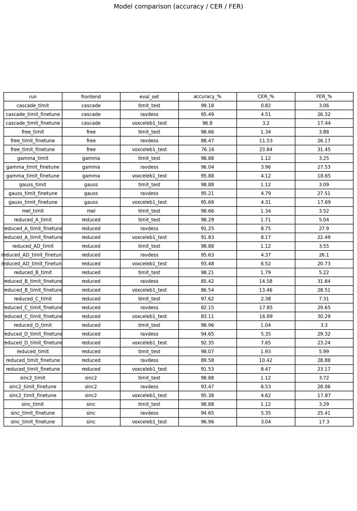

*Figure 1. Aggregated accuracy / CER / FER for all runs under `results_github/` (including fine-tune and new Reduced variants).*

---

## 6. RAVDESS after Fine-tuning (vs Paper Table 8)

| Method | Paper Acc (%) | Ours Acc (%) | Δ Acc |
|--------|-------------:|-------------:|------:|
| Free-CNN | 93.54 | 88.47 | −5.07 |
| Sinc | 96.32 | 94.65 | −1.67 |
| Sinc2 | 94.86 | 93.47 | −1.39 |
| Gamma | 97.78 | 96.04 | −1.74 |
| Gauss | 93.19 | **95.21** | **+2.02** |
| Cascade | 97.99 | 95.49 | −2.50 |
| Reduced (Mean-shift) | 96.11 | 89.58 | −6.53 |

Gauss exceeds the paper mean on RAVDESS in this single run. Cascade remains strong. Paper Reduced drops more, consistent with a frozen 43-filter bank trained with a short / small fine-tune.

---

## 7. VoxCeleb1-test after Fine-tuning (vs Paper Table 7)

| Method | Paper Acc (%) | Ours Acc (%) | Δ Acc |
|--------|-------------:|-------------:|------:|
| Free-CNN | 97.48 | 76.16 | −21.32 |
| Sinc | 97.66 | **96.96** | −0.70 |
| Sinc2 | 96.33 | 95.38 | −0.95 |
| Gamma | 97.17 | 95.88 | −1.29 |
| Gauss | 96.74 | 95.69 | −1.05 |
| Cascade | 97.27 | 96.80 | −0.47 |
| Reduced (Mean-shift) | 97.44 | 91.53 | −5.91 |

**Sinc** is the best transfer model here and is within **0.7%** of the paper. Free-CNN collapses on Vox (unconstrained frontend overfits TIMIT / small Libri fine-tune). Cascade stays within **0.5%** of the paper on this split.

---

## 8. Training Curves

### 8.1 Cascade (best full AFM)

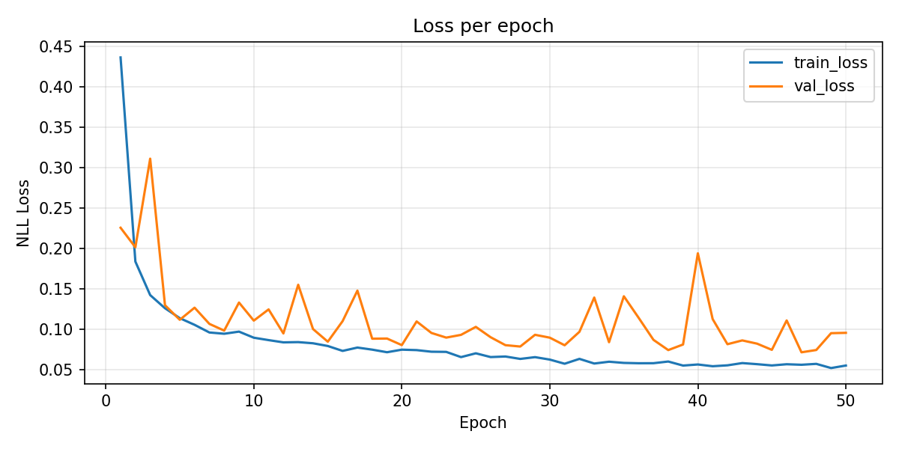

*Figure 2. Cascade TIMIT training / validation NLL over 50 epochs.*

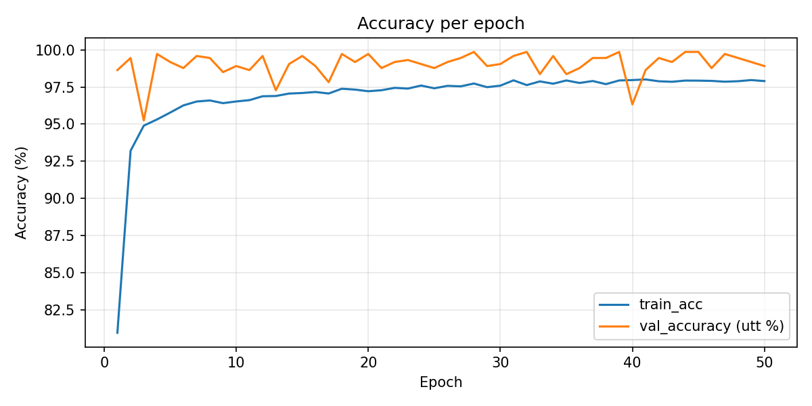

*Figure 3. Cascade TIMIT chunk train accuracy vs utterance-level validation accuracy. Validation saturates near ceiling early; the final test Acc is 99.18%.*

### 8.2 Other frontends (TIMIT accuracy)

| Free | Sinc | Sinc2 |
|:----:|:----:|:-----:|
| 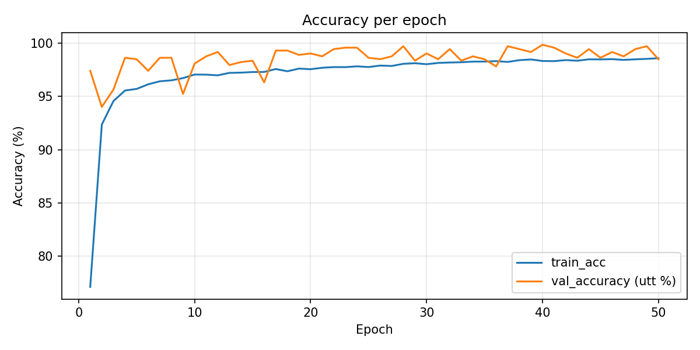 | 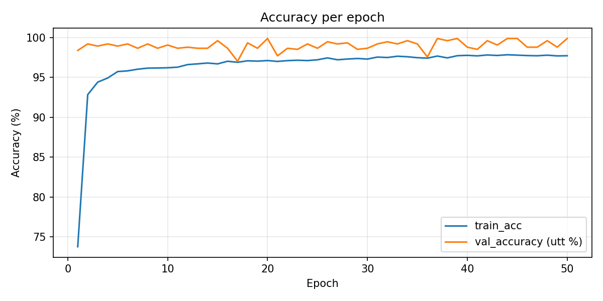 | 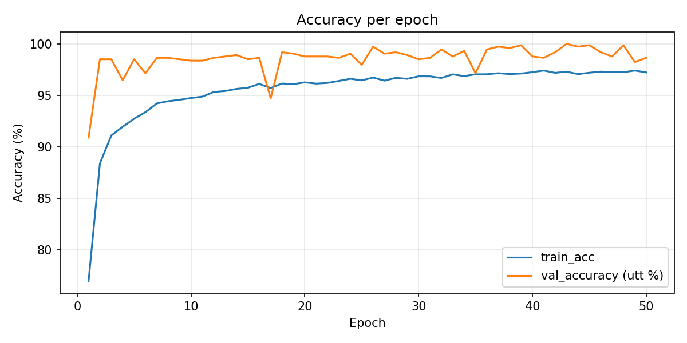 |

| Gamma | Gauss | Paper Reduced |
|:-----:|:-----:|:-------------:|
| 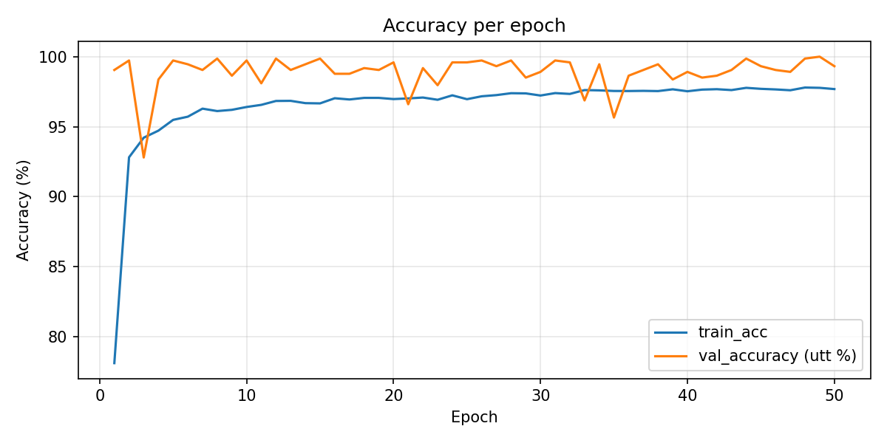 | 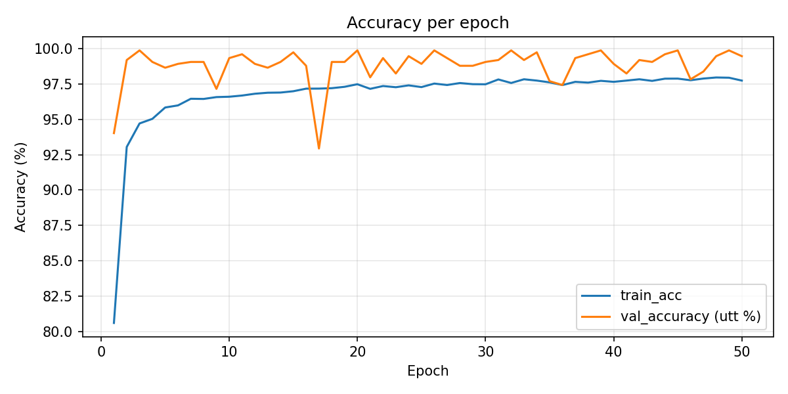 | 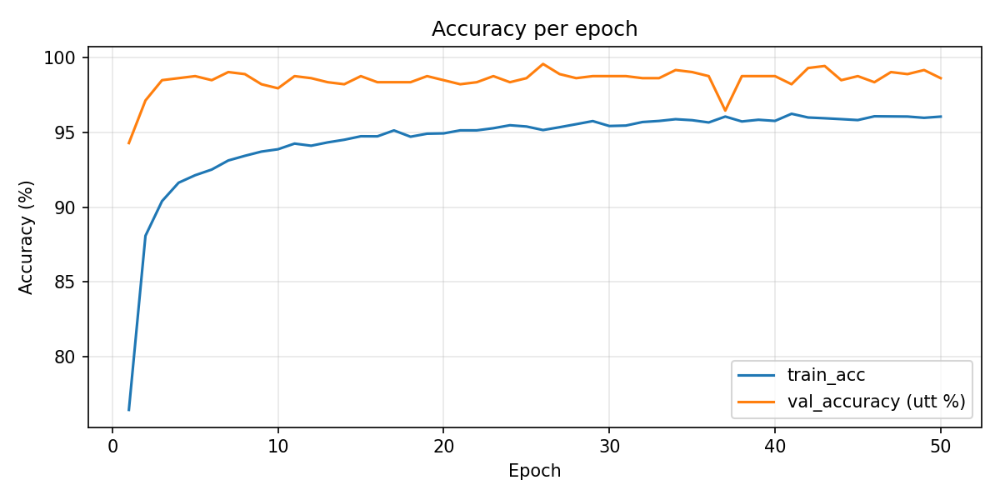 |

*Figure 4. TIMIT accuracy curves for Free, Sinc, Sinc2, Gamma, Gauss, and paper Reduced. Constrained AFMs converge smoothly; Free is noisier; Reduced (43 frozen filters) reaches high val Acc but trails Cascade on test CER/FER.*

---

## 9. Filter Interpretability (Cascade)

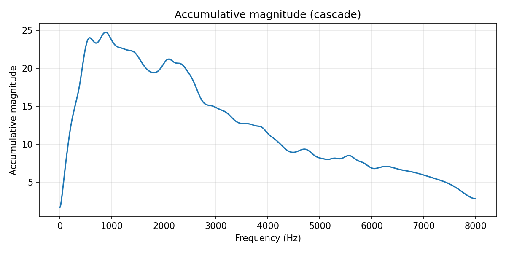

*Figure 5. Accumulative magnitude of learned Cascade filters. Coverage spans the speech band with emphasis shaped by training.*

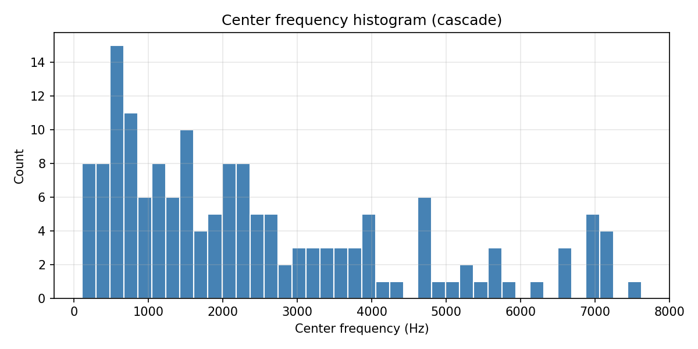

*Figure 6. Histogram of Cascade center frequencies \(f_c=(f_1+f_2)/2\). Mass at low–mid frequencies is consistent with gender cues (F0 / lower formants).*

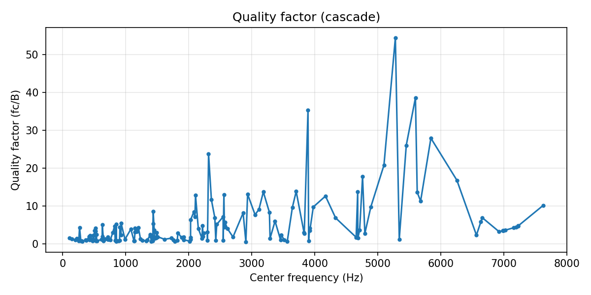

*Figure 7. Quality factor \(Q=f_c/\mathrm{BW}\) of Cascade stages. Higher \(Q\) means sharper filters.*

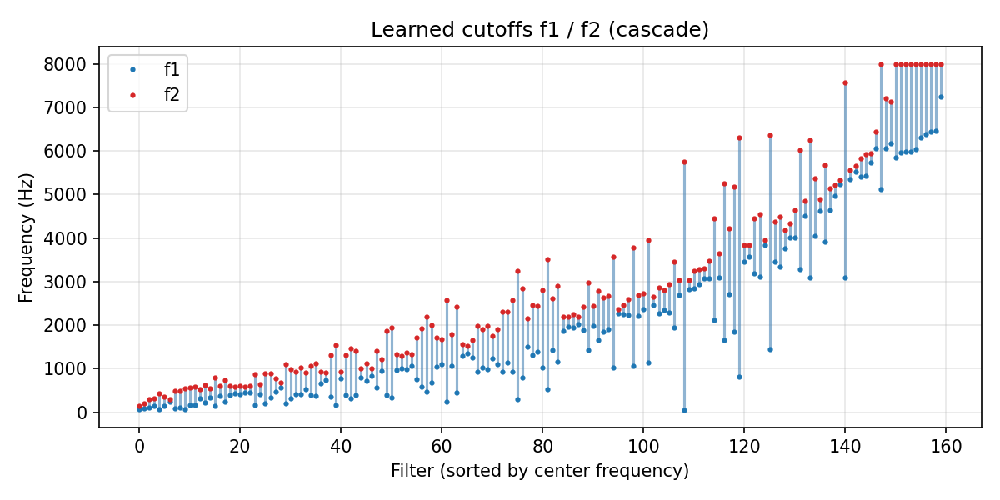

*Figure 8. Learned cutoff pairs \((f_1,f_2)\) for both Cascade stages (160 bands). This is the input to pole reduction.*

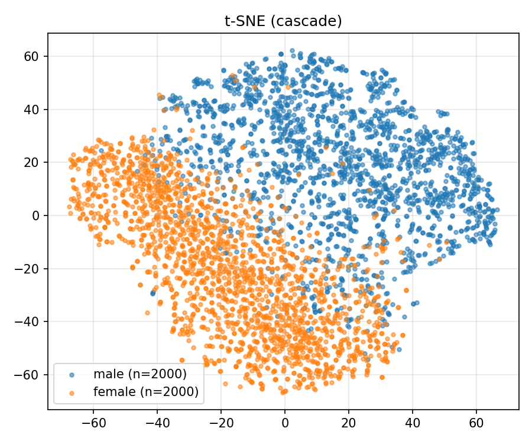

*Figure 9. t-SNE of Cascade conv features on a gender-balanced TIMIT subset. Male (blue) and female (orange) form largely separable clouds — consistent with 99%+ Acc.*

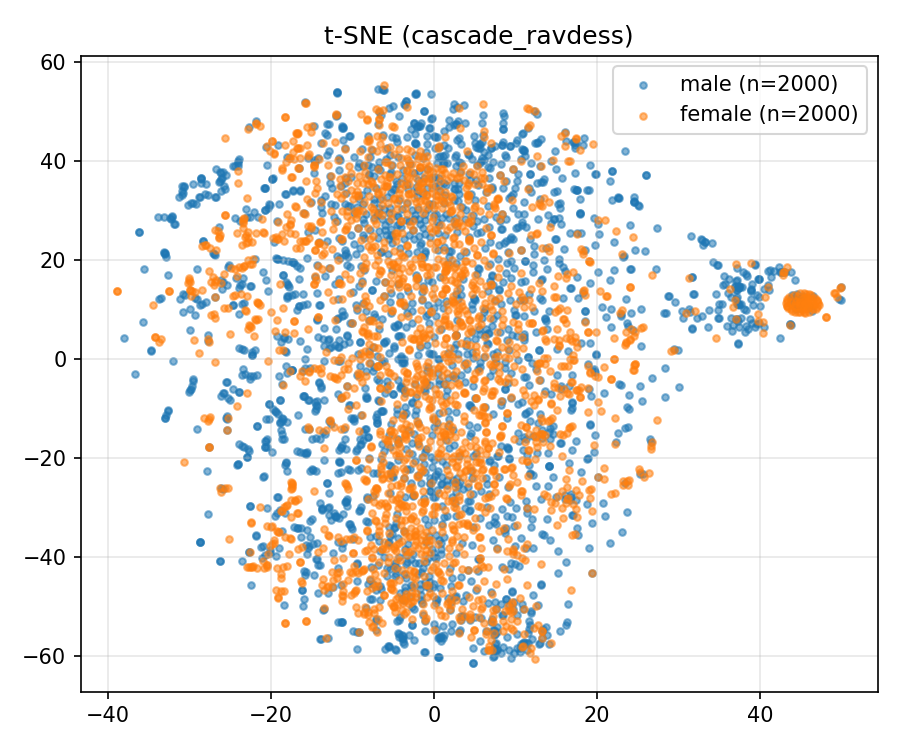

*Figure 10. Same Cascade model after LibriSpeech fine-tune, features on RAVDESS. Separation remains clear though clusters are less tidy than on TIMIT (domain shift / acted emotion).*

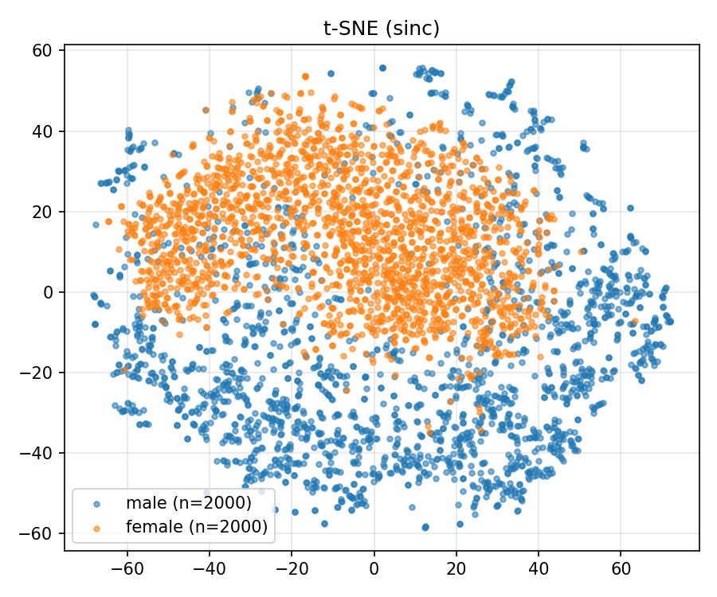

*Figure 11. Sinc TIMIT t-SNE (best Vox transfer frontend).*

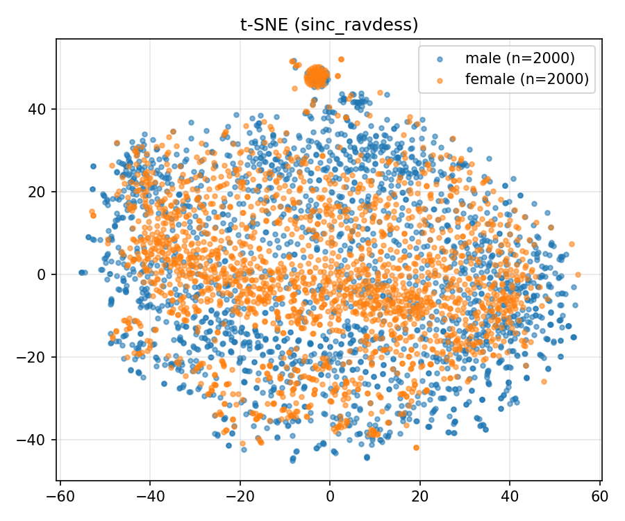

*Figure 12. Sinc after fine-tune on RAVDESS features.*

---

## 10. Paper Reduced Model (Mean-shift Pole Reduction)

### 10.1 Algorithm (authors)

1. Take both Gaussian stages of each of 80 Cascade filters → **160** bands `(f1, f2)`.
2. Map to poles \(x=e^{-\sigma+j\omega_0}\) with  
   \(\omega_0=2\pi(f_1+f_2)/(2f_s)\), \(\sigma=2\pi(f_2-f_1)/f_s\).
3. Cluster with **MeanShift(bandwidth = 0.079)** on \((\mathrm{Re}\,x,\,\mathrm{Im}\,x)\).
4. Each cluster → mean `(f1, f2)`; rebuild **frozen sinc²** bank.
5. Retrain CNN body 50 epochs on TIMIT; then fine-tune 20 epochs.

**This run:** 160 poles → **43** filters.

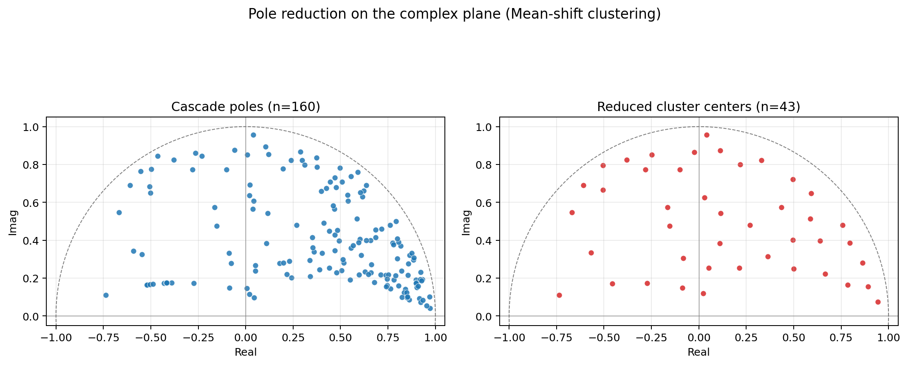

*Figure 13. Left: 160 Cascade poles inside the unit circle. Right: Mean-shift cluster centers (43). Angle ≈ center frequency; radius relates to bandwidth.*

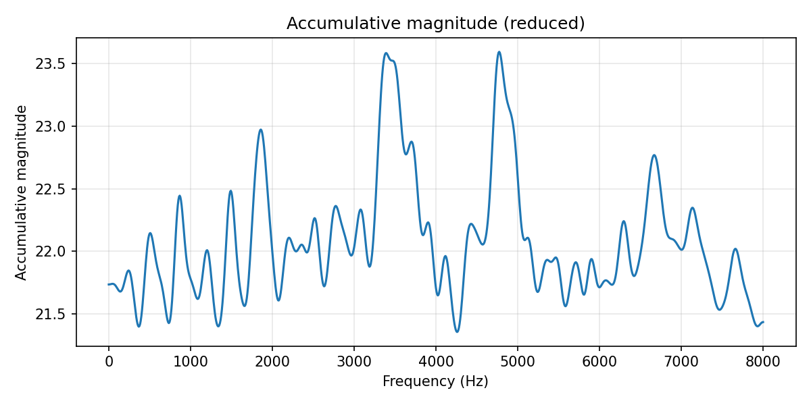

*Figure 14. Accumulative magnitude of the paper Reduced (43 sinc²) bank.*

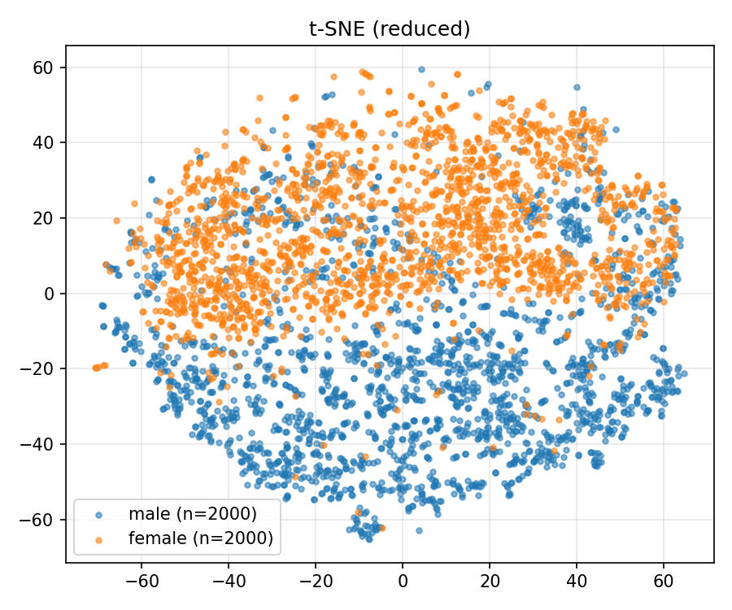

*Figure 15. t-SNE for paper Reduced on TIMIT. Gender structure remains, but margins are softer than Cascade — matching higher FER (5.99%).*

---

## 11. Innovation: Alternative Reduced Filter Banks

### 11.1 Motivation

Paper Mean-shift reduction is simple but has clear weaknesses for gender SID:

1. **Task-agnostic** — merges poles without asking which help male/female.
2. **Frequency-uniform distance** on the complex plane (~200 Hz radius) — too coarse near F0, too fine at high frequencies.
3. **Splits** each Cascade filter into two independent poles.
4. **Freezes** cutoffs after clustering — no recovery if centers are slightly wrong.
5. \(K\) is an indirect side-effect of bandwidth — we fix \(K=43\) for all variants for fair comparison.

### 11.2 Methods (equal \(K = 43\))

| ID | Selection | Training |
|----|-----------|----------|
| **A** | Task-aware **ERB-warped** weighted mean-shift (Taylor attribution + gender Fisher on filter energy) | Frozen sinc² + CE |
| **B** | Learnable **L0 / hard-concrete gates** on Cascade filters; keep top-\(K\) | Frozen sinc² + CE |
| **C** | **Agglomerative** clustering of the 80 **effective** Cascade magnitude responses | Frozen sinc² + CE |
| **D** | Paper Mean-shift centers | **KD** from Cascade + **trainable** f1/f2 |
| **AD** | Same filters as A | KD + trainable f1/f2 (**proposed combo**) |

Details and suggested paper wording: `INNOVATION_REDUCED_NOTES.md`.

### 11.3 Quantitative comparison

| Model | #filters | TIMIT Acc | RAVDESS Acc | VoxCeleb1 Acc |
|-------|---------:|----------:|------------:|--------------:|
| Cascade (teacher) | 80 | **99.18** | 95.49 | **96.80** |
| Paper Reduced (Mean-shift) | 43 | 98.07 | 89.58 | 91.53 |
| **A** task-aware ERB | 43 | 98.29 | 91.25 | 91.83 |
| **B** L0 gates | 43 | 98.21 | 85.42 | 86.54 |
| **C** response clustering | 43 | 97.62 | 82.15 | 83.11 |
| **D** Mean-shift + KD + unfreeze | 43 | **98.96** | 94.65 | 92.35 |
| **AD** A + KD + unfreeze | 43 | 98.88 | **95.63** | **93.48** |

Δ vs paper Reduced (same \(K\)):

| Variant | Δ TIMIT | Δ RAVDESS | Δ Vox |
|---------|--------:|----------:|------:|
| A | +0.22 | +1.67 | +0.30 |
| B | +0.14 | −4.16 | −4.99 |
| C | −0.45 | −7.43 | −8.42 |
| D | **+0.89** | **+5.07** | +0.82 |
| **AD** | +0.81 | **+6.05** | **+1.95** |

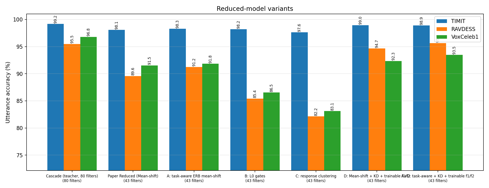

*Figure 16. Side-by-side Acc for Cascade, paper Reduced, and variants A/B/C/D/AD on TIMIT, RAVDESS, and VoxCeleb1-test.*

### 11.4 Method-specific figures and interpretation

#### A — Task-aware ERB clustering

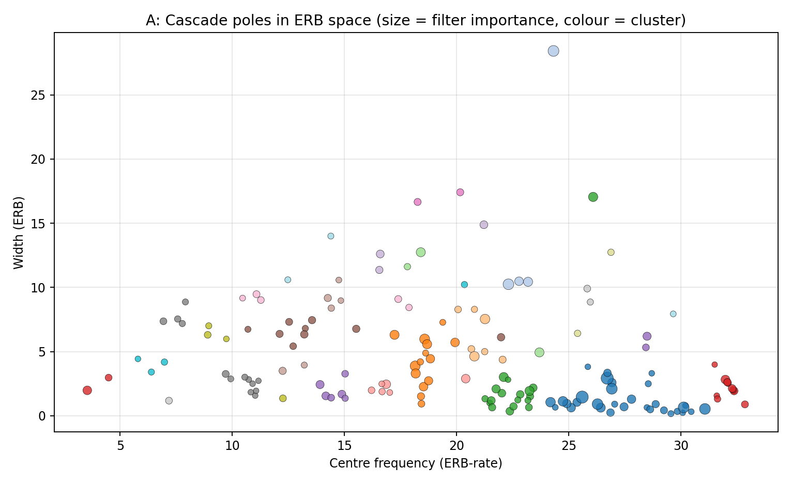

*Figure 17. Cascade poles in ERB-rate space (x = center frequency in ERBs, y = width in ERBs). Marker size is proportional to importance (Taylor + Fisher); colour = cluster. Low-frequency poles stay better resolved than on the complex plane.*

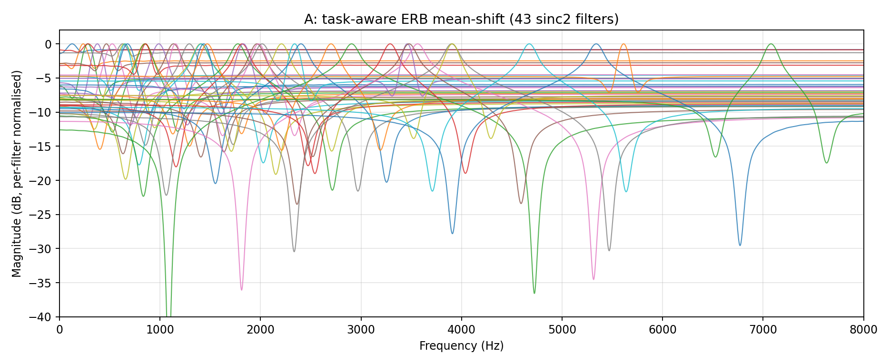

*Figure 18. Resulting 43 sinc² filters for A. Dense coverage at low frequencies matches the gender-relevant band.*

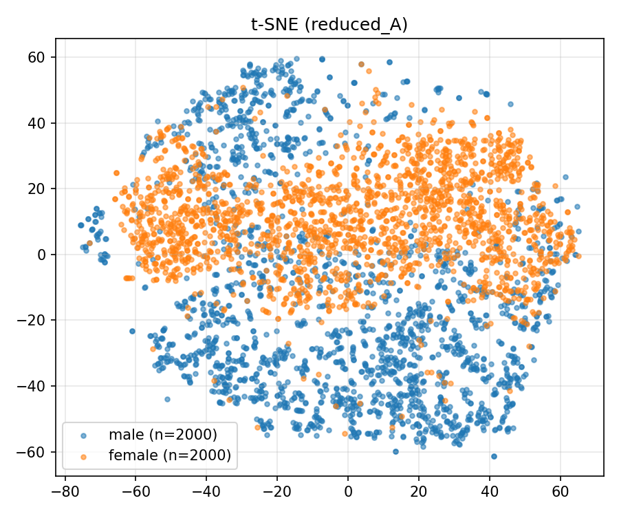

*Figure 19. TIMIT t-SNE for A. Clearer gender structure than paper Reduced in Fig. 15, consistent with the +0.22 Acc / lower FER trend vs Mean-shift alone.*

**Takeaway:** A alone is a modest but consistent win over paper Reduced on all three sets. The larger gains come when A is paired with D.

#### B — L0 gates

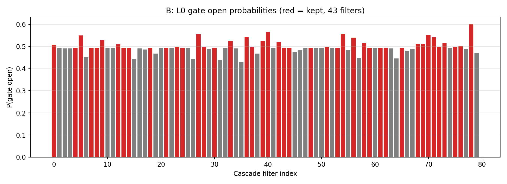

*Figure 20. Learned open probability per Cascade filter (red = kept). Selection is sparse and task-driven, but the short gate stage (10 epochs) + frozen sinc² reconstruction underperformed on OOD sets.*

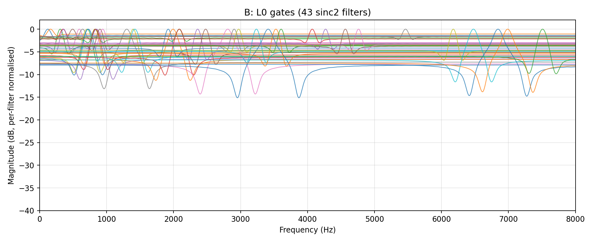

*Figure 21. B’s reduced sinc² bank. Competitive on TIMIT (98.21%) but weak transfer (RAVDESS 85.42%, Vox 86.54%).*

**Takeaway:** End-to-end pruning is a valid baseline; with this schedule it is **not** competitive for generalization. Useful negative result for the report.

#### C — Response clustering

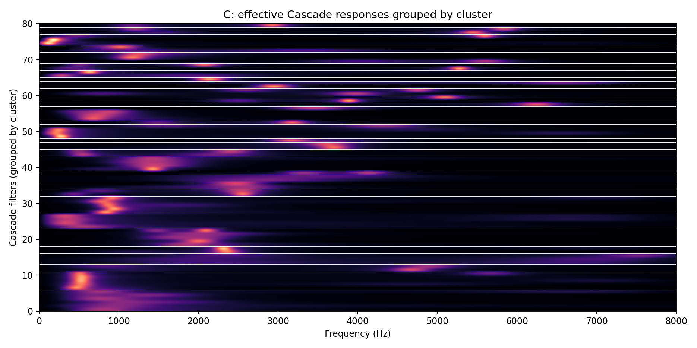

*Figure 22. Effective Cascade magnitude responses grouped by agglomerative clusters. This respects the two-stage cascade but average prototypes can blur discriminative bands.*

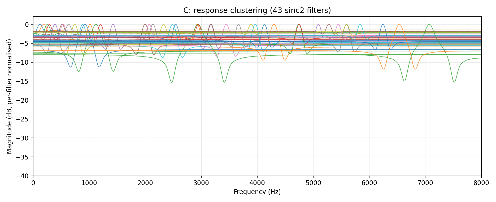

*Figure 23. C filter bank — weakest Reduced variant overall (TIMIT 97.62%, large OOD drop).*

**Takeaway:** Clustering on responses alone (no task weight, no distillation) is insufficient at \(K=43\).

#### D — Distillation + trainable cutoffs (paper selection)

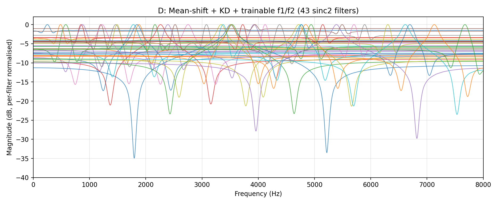

*Figure 24. D starts from the same Mean-shift centers as paper Reduced, but trains with Hinton KD (\(T=4\), \(\alpha=0.5\)) and **unfrozen** f1/f2. TIMIT Acc rises to **98.96%** (+0.89 vs frozen Mean-shift); RAVDESS to **94.65%** (+5.07).*

**Takeaway:** Much of the Reduced gap is a **training** problem, not only a clustering problem.

#### AD — Proposed combination (A selection + D training)

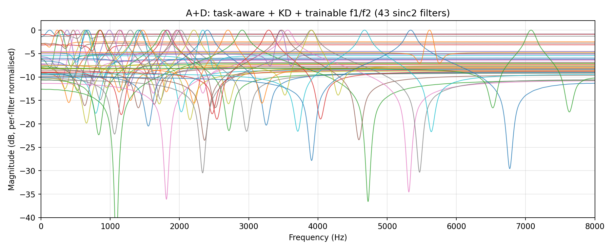

*Figure 25. AD filter bank (A’s bands, refined during training).*

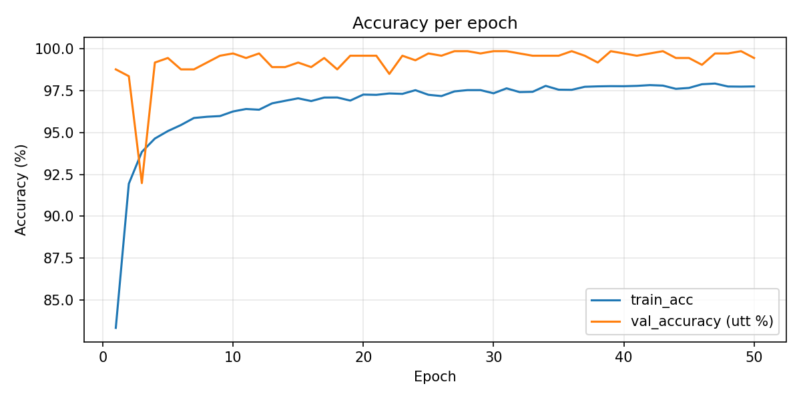

*Figure 26. AD TIMIT training curve (CE + KD, trainable frontend).*

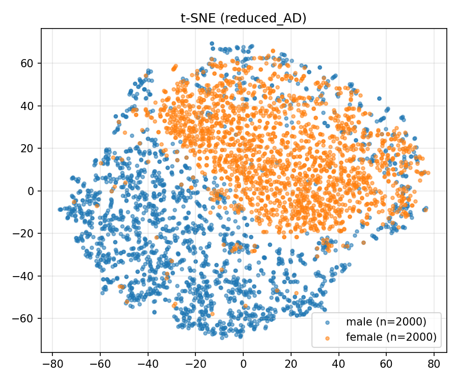

*Figure 27. AD TIMIT t-SNE — tight gender separation with only 43 filters.*

**Takeaway:** **AD is the best Reduced model for transfer** in this study (RAVDESS **95.63%**, even **above Cascade’s 95.49%** on this run; Vox **93.48%**, +1.95 vs paper Reduced). On TIMIT it is essentially tied with D (98.88% vs 98.96%) and far above frozen Mean-shift (98.07%).

---

## 12. Analysis of Discrepancies vs the Paper

### 12.1 TIMIT (close)

Most full AFM frontends are within ~0.2% Acc of Table 4. Cascade essentially matches. Gaps are consistent with **50 vs 500** epochs and **one seed** vs mean±std over three runs.

### 12.2 Reduced vs paper Reduced

Our paper-style Reduced is weaker (98.07% vs reported 99.03%). Contributing factors: different realized \(K\) (**43** here), 50-epoch retrain, and Cascade checkpoint differences. Innovation variants **D/AD largely close the in-domain gap** and **beat our paper Reduced on OOD by a large margin**.

### 12.3 RAVDESS / VoxCeleb1-test

Remaining gaps vs published OOD tables are dominated by:

1. Fine-tune **20 vs 200** epochs.  
2. **dev-clean** instead of **train-clean-360**.  
3. VoxCeleb1-**test** only vs broader Vox evaluation in the paper.  
4. Single run (seed 42).

Despite that, Sinc/Cascade/Gauss stay close on several cells, and **AD almost matches Cascade on RAVDESS with ~half the filters**.

---

## 13. Conclusions

1. The GitHub-aligned pipeline **faithfully reproduces** in-domain AFM ranking: **Cascade** is best on TIMIT; constrained AFMs beat Free on transfer.  
2. Paper **Mean-shift Reduced** (43 frozen sinc²) is a compact baseline but loses OOD accuracy under our short fine-tune.  
3. **Innovation:** at equal \(K=43\),  
   - **D** shows distillation + unfreezing recovers most of the Reduced gap;  
   - **A** gives a small selection gain;  
   - **AD** is the best overall Reduced proposal (**best RAVDESS / Vox among Reduced**);  
   - **B** and **C** are informative baselines that underperform on transfer.  
4. For a deployment story: **AD offers Cascade-level RAVDESS Acc with 43 filters instead of 80.**

---

## 14. Contribution Bullets (for abstract / thesis)

- Reproduced SGR_AFM frontends (sinc / sinc2 / gamma / gauss / cascade / free / mel) with authors’ cutoff and kernel parameterization.  
- Reported TIMIT / RAVDESS / VoxCeleb1-test results under a fixed, resumable pipeline (`results_github`).  
- Diagnosed limitations of Mean-shift pole reduction for gender SID.  
- Proposed **A** (task-aware ERB-weighted mean-shift), **B** (L0 gates), **C** (response clustering), **D** (KD + trainable cutoffs), and **AD**.  
- Showed **AD** improves RAVDESS Acc by **+6.05** and Vox by **+1.95** over paper Reduced at the **same** filter count (43).

---

## 15. File Map

| Path | Role |
|------|------|
| `run_all_paper.bat` | Main paper pipeline (resumable) |
| `new_reduced_pipeline.bat` | Innovation Reduced variants |
| `afm_sgr/filters.py` | AFM kernels + cutoffs |
| `afm_sgr/reduced.py` | Paper Mean-shift Reduced |
| `afm_sgr/reduced_new.py` | Methods A–D |
| `INNOVATION_REDUCED_NOTES.md` | Longer method notes for writing |
| `results_github/` | All metrics, checkpoints, plots |
| `report_figures/` | Figures embedded above |

---

## 16. Figure Index

| Fig | File | Content |
|-----|------|---------|
| 1 | `comparison_table.png` | All-run metrics table |
| 2–3 | `cascade_timit_{loss,accuracy}.png` | Cascade training |
| 4 | `*_timit_accuracy.png` | Other frontend curves |
| 5–8 | `accum_mag / fc_hist / Q / f1_f2_cascade` | Cascade interpretability |
| 9–12 | `tsne_*.png` | Feature embeddings |
| 13–15 | pole plane, Reduced mag, Reduced t-SNE | Paper Reduced |
| 16 | `new_reduced_comparison.png` | Innovation bar chart |
| 17–19 | A ERB / bank / t-SNE | Method A |
| 20–21 | B gates / bank | Method B |
| 22–23 | C clusters / bank | Method C |
| 24 | D bank | Method D |
| 25–27 | AD bank / curve / t-SNE | Proposed AD |

All original high-resolution plots also live under each run’s `results_github/<run>/figures/` directory.
